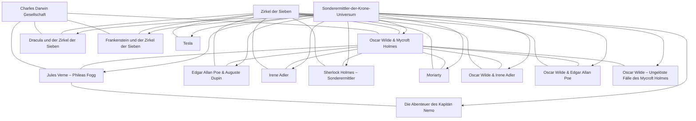

# Quellenlage & Kanonkarte

> Meta-Auswertung der Deep-Research-Recherche ([raw/deep-research-report.md](../../raw/deep-research-report.md)): Welche Quelle ist wofür belastbar, plus eine kondensierte Kanon-Beziehungskarte des Universums.

## Quellen-Eignung (welche Quelle wofür)

| Quelle | Stark für | Schwach / Lücken |
|---|---|---|
| **sonderermittler-der-krone.de** (Fanseite, Betreiber Tim Gerundt) | Reihenstruktur, Kanonzuordnung, Episodenreihenfolge, Episoden-/Cover-URLs, Kurzinhalt, Figurenliste | Vollständige Credits, Labels, exakte Handelsdaten, Katalognummern; ältere Folgen oft nur Jahr + Laufzeit; **redaktionelle Fehler** (siehe Tesla 1) |
| **HolyShop / Holysoft** | Maritim-Handelsdaten: Produkttyp, Label, Genre, Altersempfehlung, Format, oft exakte Erstveröffentlichung | „Mitwirkende" nicht immer offen ausgerollt; uneinheitlich indexierbar |
| **Kassettenkiste, Thalia, Audible, Apple Music, Storytel** | Blitz-Linien: exakte Erscheinungsdaten, Laufzeiten, EAN/ISBN, Sprecher, Plattformverfügbarkeit, teils Tracklisten | Tracklisten/Kapitelzeiten nur als Plattformdaten, nicht einheitlich über alle Folgen |
| **Black-Stone-/Zauberspiegel-Chronologie** | Serienübergreifende Kontinuität: Erstauftritte, Crossover-Ereignisse, In-Universe-Einordnung | Keine Primärquelle; nachrangig für reine Plot- oder Handelsdaten |

**Kernaufteilung:** Kanon & Ordnung → Fanseite; Verkaufs-/Handelsmetadaten → Händler; Kontinuität & Figurenwanderung → Chronologie.

## Neu bewertete Quellen (2026-09-06)

Ergebnis der Quellen-Scout-Recherche vom 06.09.2026. Alle drei sind **maschinenlesbare Schnittstellen ohne Zugangsschlüssel** und damit wiederholbar abrufbar — anders als die bisher genutzten HTML-Quellen.

| Quelle | Stark für | Schwach / Lücken |
|---|---|---|
| **Apple Music / iTunes Search API** (`itunes.apple.com/search`, Storefront DE) → [Rohdaten](../../raw/maritim/2026-09-06_apple-music-itunes-api_erscheinungsdaten.md) | **Exakte Erscheinungsdaten** für praktisch jede Folge der Hauptreihen (Fogg 1–52, OWMH 1–60, Poe & Dupin 1–36, Irene Adler 1–36, Dracula 1–16, Frankenstein 1–28, Sherlock 1–24, SHC 1–97); **Laufzeit** als Summe der Track-Zeiten (gegen 220 vorhandene `spielzeit_min`-Werte geprüft: 219 Treffer innerhalb ±2 min); Track-/Kapitelzahl; **kanonische Titelschreibweise inklusive Umlauten** | Keine Sprecher, keine EAN/ISBN. **Wichtigste Einschränkung:** Das gelieferte `releaseDate` ist das **digitale** Veröffentlichungsdatum und **nicht** durchgängig identisch mit dem Handelstermin, den der Vault bisher aus Fanseite und HolyShop bezogen hat. Gegenprobe an 135 Folgen, deren exaktes Datum bereits belegt war: **101 identisch (75 %), 34 abweichend** (diese Abweichungen hat der HolyShop-Abgleich vom 12.10.2026 überwiegend zugunsten von Apple aufgelöst, siehe Nachtrag unten), Spanne −77 bis +77 Tage. Verteilung ungleich — `irene-adler` 32/32, `sherlock-holmes` 18/20, aber `oscar-wilde-und-mycroft-holmes` nur 28/55. Reihen ohne vollständigen Streaming-Katalog: **Moriarty (0 Folgen), Tesla (nur Folge 1), Kapitän Nemo (4)**. **Verwechslungsgefahr:** Parallellinien mit eigener Zählung (`Aus den Archiven`, `Die alten Fälle (Reloaded)`), englische Ausgaben, Sammelboxen und die Roman-Lesereihe `In 80 Tagen um die Welt` müssen vor dem Parsen ausgefiltert werden |
| **Deezer API** (`api.deezer.com`) → [Rohdaten](../../raw/maritim/2026-09-06_deezer-api_erscheinungsdaten-und-upc.md) | Unabhängige **Zweitbestätigung** der Apple-Daten (106 von 113 neu gesetzten Daten doppelt belegt); **UPC/EAN** je Album | Feld `duration` ist **unbrauchbar** (Dracula 1: 2263 s = 37,7 min statt real ~70 min). Volltextsuche mischt Nachbarreihen ein, Filter über den Interpretennamen ist Pflicht. Keine Sprecher, keine Autor:innen |
| **DNB SRU** (Deutsche Nationalbibliothek, `services.dnb.de/sru/dnb`) | **ISBN/EAN** der CD-Ausgaben, Verlagsfirma (`Timm + Wilken oHG, Schenefeld` hinter dem Label Maritim), Erscheinungsjahr, Preisbindung; weist auch **geplante Titel** vor Erscheinen nach | Nur Jahresangabe, kein Tagesdatum. `dc:creator` ist die Firma, nicht die Autor:in — für Autorschaft unbrauchbar. Keine Sprecher (**überholt am 12.10.2026:** Feld 700 der Digitalausgaben liefert vollständige Sprecherlisten, 245 $c der CDs die Hauptrolle und die Autorschaft — siehe Abschnitt 2026-10-12). Titelschreibweise fehlerhaft (Beispiel: „Gegen jeden Wiederstand" statt „Widerstand") |
| **Hörspieltalk-Forum** (Ankündigungsthreads, geben die Verlagsvorschau wieder) | **Titel, Klappentext und Besetzung** kommender Folgen — oft Monate vor allen anderen Quellen und bislang ohne Gegenbeleg falsch | **Datumsangaben sind unbrauchbar.** Für die Herbst-2026-Staffel lagen sie durchgängig **zu früh**: SH 24 −70 Tage, FRANK 28 −49, IADK 35 −14, OWMH 60 −7 (Gegenprobe Apple Music + Deezer, 06.09.2026). Ursache ist vermutlich die Wiedergabe früher Vorschautermine, die der Verlag später verschiebt. **Regel: Titel und Inhalt von dort übernehmen, Termine niemals ohne Plattformbeleg.** Zusätzlich uneinheitlich bei der Verlagszuordnung — führt die WMU-Reihe unter „Maritim" statt „Blitz Verlag" (bildet den Vertriebsweg ab; Zuordnung Blitz am 12.10.2026 festgeschrieben) |

**Merksatz für den Datentyp:** Streaming-APIs sind die beste Quelle für das **Datum**. Bei der **Laufzeit** führt der in `raw/` belegte Wert der Fanseite; die Apple-Trackssumme ist nur Ersatz, wo die Fanseite keinen Wert nennt (sie lag in 15 Vergleichsfällen genau 1 min darüber — Regel bestätigt von Christian am 12.10.2026, siehe Fallstrick unten). Bibliotheks- und Händlerdaten für **ISBN/EAN und Verlag**, und weiterhin ausschließlich die Händler-Detailseiten (HolyShop, Audiolibrix, Nextory) für **Autor:in** (seit 13.10.2026 zusätzlich Raute Media, Feld „Künstler“, und die DNB-CD-Sätze als vom Digitalstrom unabhängige Autorenquellen — siehe Abschnitt 2026-10-13). Für **Sprecher:innen** existierte bis dahin **keine** flächendeckende maschinenlesbare Quelle; seit dem 12.10.2026 liefert die DNB-SRU (Feld 700 der Digitalausgaben) vollständige Namenslisten, allerdings **ohne Rollen** (siehe unten).

### Neu gefundene Quellen-Fallstricke

- **`autor` ist Einzelquelle und bleibt es — entschieden am 06.09.2026:** Die 221 am 06.09.2026 nachgetragenen Autorenangaben stammen ausschließlich aus der Hörbuchsparte der iTunes Search API; die Fanseite nennt keine Autor:innen, eine zweite flächige Quelle existiert nicht. Damit unterschreitet das Feld die sonst geltende Zwei-Quellen-Regel. **Entscheidung (Christian): Werte bleiben stehen, das Feld ist für die Vault-Ziele nachrangig.** Keine weitere Recherche, aber auch keine Belastung von Aussagen durch `autor`. Wer das Feld auswertet, behandelt es als Einzelbeleg.
  - **Fortgeschrieben am 13.10.2026:** Die Regel bleibt, die Beleglage ist besser. Mit Raute Media (Feld „Künstler“) und den DNB-CD-Sätzen gibt es jetzt zwei vom Digitalstrom unabhängige Autorenquellen; die Autorangaben von 150 Folgen sind durch Raute Media gegengeprüft (98 bestehende Werte, 52 neu eingetragene; keine Abweichung außer EAPAD 33/34). DNB-Digitalausgabe, Apple Books, Audiolibrix und LovelyBooks/Audible zählen für `autor` als **eine** Quelle. Apple Books führt inzwischen auch Moriarty 0–27 und Sherlock Holmes 1–23. Am 13.10.2026 sind 68 leere Felder nachgetragen (79 → 11); MOR 25–27 stützen sich nur auf den Digitalstrom und sind als Einzelquelle gekennzeichnet ([Rohdaten](../../raw/maritim/2026-10-13_dnb-rautemedia-applebooks-fanseite_autor-datum-altfaelle.md), [[wiki/queries/lint-2026-10-12|Lint 2026-10-12, Nachtrag 7]]).
  - **Fehlermuster SHC (13.10.2026):** Bei SHC 19 und SHC 26/27 nennt der Digitalstrom einen anderen Namen (Thomas Tippner, Oliver Fleischer) als Booklet und Fandom (Jonas Maas). Keine Quelle nennt beide Namen nebeneinander oder trennt nach „Autor“ und „Dialogbuch“; `autor` von SHC 26/27 ist bis zur Entscheidung unverändert.

- **Nummernkollision durch Parallellinien:** Die iTunes/Deezer-Suche liefert für Poe & Dupin die Reihe `Aus den Archiven` mit eigener Zählung 1–12 mit. Ungefiltert überschreibt „Aus den Archiven, Folge 12: Die Klinik-Morde" (20.11.2020) die echte Folge 12 „In den Katakomben lauert der Tod" (29.01.2021). Dasselbe Muster bei `Sherlock Holmes – Die alten Fälle (Reloaded)` und bei Fogg durch `In 80 Tagen um die Welt`.
- **Laufzeit-Widerspruch DNAPF 36 „Der letzte Tag auf Erden":** Vault 58 min, Apple-Music-Trackssumme 67,7 min. Einziger Ausreißer unter 220 Vergleichswerten — Klärung offen. **Erledigt am 13.10.2026:** Die Fanseite nennt live „68 min“ (Apple Music 67,7 min, Deezer 67,4 min); der Wert 58 stammte aus der Abschrift vom 29.04.2026. Nach der Regel „Fanseite vor Apple-Trackssumme“ gilt 68. Der Vollabgleich zeigt: Die Abschriften vom 27.–30.04.2026 stimmen in 276 von 277 Fällen mit der Live-Fanseite überein.
- **1-Minuten-Versatz Fanseite ↔ Apple-Trackssumme (Lint 12.10.2026):** Bei 15 Folgen (OWMH 1, 2 · EAPAD 3, 5, 7, 8, 10, 14, 17, 18, 19, 20 · WPO 1, 2, 4) lag die Apple-Summe genau 1 min **über** dem Fanseitenwert — vermutlich Aufrundung der Track-Summe gegenüber abgeschnittenen Minuten auf der Fanseite (Annahme, nicht belegt). Die Track-Summen selbst stehen in keiner `raw/`-Datei. `spielzeit_min` führt deshalb in diesen Fällen den in `raw/` belegten Fanseitenwert; die Apple-Summe bleibt für Folgen ohne Fanseitenwert maßgeblich. Details: [[wiki/queries/lint-2026-10-12|Lint 2026-10-12]].
- **Zwei Datumsbegriffe — entschieden am 06.09.2026:** Die an diesem Tag nachgetragenen 113 Erscheinungsdaten sind **digitale Veröffentlichungsdaten** aus Apple Music (106 davon zusätzlich durch Deezer bestätigt). Für Folgen, deren Handelstermin bereits belegt war, weichen diese in rund einem Viertel der Fälle ab. Das Feld `erschienen` mischt damit zwei Ereignisarten. **Entscheidung (Christian): bleibt so.** Kein neues Feld, keine Rücknahme. Begründung: `erschienen` dient im Vault nicht der Handelsdokumentation, sondern als Indiz für die **Timeline und für Handlungsverläufe zwischen Serien**. Dafür reicht die Genauigkeit — siehe die Granularitätsregel unten. Jede betroffene Folgenseite nennt die Quelle weiterhin im Eckdaten-Abschnitt; überschrieben wurde kein bereits tagesgenau belegtes Datum (Gegenprobe gegen den Stand vor dem Lauf: 114 Einträge neu datiert, davon 73 vorher jahresgenau und 41 ohne Datum, **0 Regressionen**).
  - **Revidiert am 12.10.2026 (Entscheidung Christian):** Die Voraussetzung, die abweichenden Vault-Werte seien belegte Handelstermine, trifft nicht zu — die HolyShop-Ersterscheinung stimmt in 34 Fällen mit Apple überein und widerspricht dem Vault; die Vault-Werte stammten überwiegend aus der „Repo-Timeline“ der Anlagephase bzw. der Löchel-Chronologie. Diese 34 Folgen und MOR 25 führen seitdem die Ersterscheinung. Für die übrigen Folgen gilt weiter: `erschienen` = Ersterscheinung (digital), siehe „Drei Datumsebenen“ unten. Tabelle alt → neu: [[wiki/queries/lint-2026-10-12|Lint 2026-10-12, Nachtrag 4]].

> [!important] Granularitätsregel für `erschienen`
> **Belastbar ist die Zuordnung zum Release-Block, nicht die tagesgenaue Reihenfolge zwischen Serien.**
>
> Maritim liefert mehrere Serien im selben Schwung aus. Von den 141 tagesgenau neu datierten Folgen liegen **118 innerhalb einer Woche** neben einer Folge aus einer anderen Serie, und die Abstände häufen sich exakt auf **0 und 7 Tage** — das ist der Veröffentlichungstakt, keine Streuung. Beispiele: DNAPF 19 und OWMH 20 beide am 29.03.2019, DNAPF 20 und OWMH 21 beide am 31.05.2019, EAPAD 6 am 26.07.2019 und OWMH 22 am 31.07.2019 (bis 12.10.2026 im Vault ebenfalls 26.07.2019 — ein Beispiel dafür, dass erst die Block-Zuordnung trägt, nicht der Tag). Die Zählung 141/118 bezieht sich auf den Stand vom 06.09.2026.
>
> Daraus folgt:
> - **Zulässig:** „Diese Folgen gehören zum selben Release-Block" — trägt die Aussage, dass zwei Serien einen Handlungsstrang parallel führen.
> - **Unzulässig:** „Folge A erschien vor Folge B", wenn der Abstand unter etwa einer Woche liegt. Dort entscheidet bei den neu datierten Folgen der Distributionszeitpunkt, nicht der Handelstermin; ein Fehler von wenigen Tagen kippt das Paar.
>
> Die Timeline-App sortiert bei gleichem Datum deterministisch nach `serie` und `nummer` (`compareFolgen` in `app/app.js`) — die Anzeige ist damit stabil, stellt aber ausdrücklich **keine** belegte Reihenfolge dar.

## Neu bewertete Quellen (2026-10-12)

Aus der Prüfung, ob der Hawthorn des Fogg-Afrika-Blocks der [[wiki/figuren/abel-hawthorn|Abel Hawthorn]] aus OWMH ist ([Rohdaten](../../raw/maritim/2026-10-12_fanseite-fandom-audible_abel-hawthorn-auftritte-und-sprecher.md)). **Ergänzt** um die Besetzungsrecherche für alle Folgenseiten vom selben Tag (Rohdaten je Reihengruppe: [OWMH 1–44 und SHC](../../raw/maritim/2026-10-12_fandom-dnb-audible_owmh-01-44-shc-besetzung.md), [DNAPF, WMU, OWIA](../../raw/maritim/2026-10-12_dnb-audible-hoerspieltalk-fanseite_dnapf-wmu-owia-besetzung.md), [IADK, EAPAD](../../raw/maritim/2026-10-12_fandom-audible-rautemedia-fanseite_iadk-eapad-besetzung.md), [MOR, FRANK](../../raw/maritim/2026-10-12_dnb-rautemedia-fandom-audible-hoerspieltalk_mor-frank-besetzung.md), [SH, DRAC, TES, NEM](../../raw/maritim/2026-10-12_audible-rautemedia-dnb-hoerspieltalk_sh-drac-tes-nem-besetzung.md)). Ergänzungen zu Raute Media, Hörspieltalk, Fanseiten-Figurenseiten und DNB 245 $c stehen in deren Zeilen im Nachtrag unten — je Quelle eine Zeile.

| Quelle | Stark für | Schwach / Lücken |
|---|---|---|
| **Fandom-Wiki sherlockholmes.fandom.com/de über die MediaWiki-API** (`api.php?action=query&prop=revisions`, ohne Zugangsschlüssel) | **Rollengenaue Besetzung** (Tabelle Rolle → Sprecher) für OWMH 1–41 vollständig; **Ergänzung Besetzungsrecherche 12.10.2026:** auch **SHC** 26/27, 41/42, 45, 48, 53, 55 (Doppelfolgen auf einer Seite), **IADK 0–15** (IADK 0 über die SHC-45-Seite), **MOR 0–8** und **SH 1/2** („Dunkle Kräfte“), jeweils mit Ansage. Liefert über mehrere Seiten gleichbleibende **Dauerbesetzungen** der Nebenfiguren ohne Fanseiten-Figurenseite (Van Helsing, Jonathan und Mina Harker, Bram Stoker, Lavache, van Dusen, Hatch, Stafford, Cross). Maschinenlesbar, wiederholbar, Volltextsuche über `list=search`; bis zur Besetzungsrecherche einzige Repo-Quelle, die Sprecher **einer Rolle** zuordnet | Keine Einzelseiten ab OWMH 45, für DNAPF, WMU, OWIA, EAPAD, IADK ab 16 (16–18 nur gelistet), MOR ab 9, SH ab 3, DRAC, TES und NEM. **OWMH 42–44 nur Rumpftabellen** (Wilde, Mycroft, Ansage), bei 42/43 im Widerspruch zu DNB/Audible (Reent Reins fehlt dort); für OWMH 43 seit 13.10.2026 nachweislich falsch (laut Rezension tritt Mycroft nicht auf) — die Rumpftabellen sind Vorlagen, kein Besetzungsbeleg. Bei SHC-Doppelfolgen eine gemeinsame Tabelle, viele SHC-Zeilen ohne Rolle; MOR 0 nur vier Rollen. Rollen bleiben **Einzelquelle** — außer der ersten Rolle, die DNB 245 $c gegenprüft. **Inkonsistent:** „Kalter Fels" (OWMH 5) nennt den „ersten Auftritt" Hawthorns, obwohl die eigene Seite zu OWMH 2 ihn schon besetzt; Rollennamen wechseln (Hawthorn/Hawthorne; „Mister Killroy“ in SHC 45 und IADK 0–4, ab IADK 9 „Killjoy“); Schreibfehler bei Sprechern und Rollen (Fritsche/Fritzsche, Uwe/Uve Teschner, Schüler/Schülert, Kirchärger, Reizenstein, „Dr. Jaboc Mahler“). Infobox-Daten teils abweichend (SHC 53: 08.05.2020 — das ist der Termin von SHC 52, der Vault-Wert 03.07.2020 ist am 13.10.2026 bestätigt; IADK 14 mit falschem Titel), Erscheinungsdaten teils nur Jahr, Laufzeiten gerundet („ca. 60" für 79 min). Rowspan-Zellen müssen beim Parsen aufgelöst werden. Der Suchindex ist unvollständig — vollständige Prüfung nur über den Seitenabruf, nicht über `list=search` |
| **Audible.de-Produktseiten** (Feld `narrators` bzw. „Sprecher beinhaltet …") | **Sprecherliste je Folge**, auch für DNAPF und WMU; per `curl` mit Browser-User-Agent abrufbar (Python-`urllib` wird mit HTTP 503 abgewiesen) | **Keine Rollenzuordnung** — taugt nur als Indiz („Sprecher X ist besetzt"), nicht als Beleg für eine Rolle. **Inhaltlich identisch mit der DNB-Digitalausgabe** (gleiche Namen in gleicher Reihenfolge, nur gekürzt), daher keine unabhängige Zweitquelle (Merksatz unten); übernimmt auch deren Fehler (FRANK 12 trägt die Liste von FRANK 9). Liste auf 15 Namen gekürzt, Serienseiten älterer Folgen auf sechs, DNAPF 1–8 nur drei Namen; IADK 5, EAPAD 12, WMU 2 und 4 ohne Sprecherfeld. Bei Blitz-Reihen stehen Hauptsprecher teils im **Autorenfeld** (TES 3–8, NEM 1, 2, 4, OWIA 1–4, WMU 2, 4). Sammelboxen („Ultimative Sammlung“) nicht mit Einzelfolgen verwechseln. `releaseDate` ist ein Plattformdatum und weicht teils ab (DNAPF 42: 29.10.2024 statt 18.10.2024, WMU 1: 09.02.2026 statt 23.01.2026) — **Muster bestätigt** im Nachtrag unten: Audible liegt nie wesentlich vor dem Hauptrelease, oft danach. Das Autorenfeld-Muster gilt auch für TES 9 und OWEP 1–4 (dort nur vier Namen je Folge). **Audiolibrix und Storytel übernehmen nur das Sprecherfeld** — Hauptsprecher aus dem Autorenfeld fehlen dort; aus diesen Listen nie per Ausschluss auf Rollen schließen (Fehlerfall TES 9: Turba statt Winczewski) |
| **DNB-SRU, Katalogsätze der Digitalausgaben** (MARC21 Feld 700 mit Relator `nrt`; Titel „Reihe, Folge N: Titel / Autor“) — neu 12.10.2026 | **Vollständige, ungekürzte Sprecherliste je Folge** (bis 22 Namen): OWMH ab Folge 9, SHC (auch je Teil einer Doppelfolge), DNAPF ab Folge 10, MOR 0–27, FRANK 1–27, DRAC 1–16; enthält jede Audible-Liste vollständig. Gegenprobe gegen Fandom OWMH 9–41 ohne fremden Namen (einzige Ausnahme OWMH 17, Leonhard Mahlich). Feld 245 $c nennt die Autorschaft (MOR 0–27 und FRANK 1–8 Marc Freund, FRANK 9–27 Silke Walter); dazu EAN der Digitalausgabe. Frei abfragbar | **Keine Rollen**; 245 $c nennt bei den Maritim-Digitalausgaben nur den Autor, keine Hauptrolle (anders als die CD-Sätze). **Keine unabhängige Zweitquelle zu Audible** (Verlagsmetadaten in zwei Kanälen) und mit denselben Fehlern (FRANK 12 = Liste FRANK 9). **OWMH 1–8:** für alle acht Folgen dieselbe Fünf-Namen-Liste — Serienangabe, nicht folgenspezifisch, nicht ausgewertet. Kein Satz mit Sprecherliste für SHC 48, SH, TES, NEM und OWIA. Tippfehler („Panzcak“, „Gabriele“, „Helmut Hauß“); Unicode in NFD (`ä` zerlegt), vor Abgleichen normalisieren |
| **Hoerspiel-Freunde.de, DNAPF-Thread 14987** (Benutzer „Captain Blitz“, Benutzertitel „All Ears GmbH“) — neu 12.10.2026 | Verlagsmitteilung 2015 mit der **Stammbesetzung der Fogg-Reihe** (u. a. Erzähler Brückner, Fogg Draeger, Aouda Braunmiller-Jest, Passepartout Clarén, Nemo Klebsch, Frankenstein Wunder, Robur Neugebauer); **komplette Rollenlisten** zu DNAPF 7 und 8 | Nur diese zwei Folgen; Forumsbeiträge, für Nebenrollen Einzelquelle |
| **hoernews.de** (private Rezensionsseite) — neu 12.10.2026 | Rollentabelle zu DNAPF 1 | Nur Folge 1, Liste endet mit „u. a.“; andere DNAPF-Seiten existieren nicht |
| **LovelyBooks-Leserrezensionen** — neu 12.10.2026 | Gelegentlich Rollenangaben zu Hauptfiguren (EAPAD 1: Poe, Dupin, Erzähler) als unabhängige Gegenprobe | Zufallsfunde, nicht systematisch auffindbar. Die Produktseiten spiegeln die Audible-Metadaten samt Klappentext je Episode und sind für `autor` keine eigene Quelle (13.10.2026) |
| **Rezensionsseiten** (Poldis Hörspielseite, Traumwelt Hörspiel) — neu 12.10.2026 | Einzelne Rollen im Fließtext (Poldi u. a. DNAPF 1–34, DRAC; Traumwelt DRAC-Box 1), gute Gegenprobe für Stammbesetzungen. **Ergänzung 13.10.2026:** weitere Poldi-Serienseiten (z2337 OWMH, z3306 IADK, z2212 DNAPF 1–34, z3578 MOR 1–16, z3580 FRANK 1–16) und Board 191 im Hörspieltalk (neuere Rezensionen, z. B. MOR 18) — brauchbar für Aussagen, **ob eine Figur vorkommt** (OWMH 43: Mycroft nicht), für Hinweise auf fehlerhafte CD-Rückseiten (SH 8) und für Rollen im Fließtext als Gegenprobe | Keine Listen; Einzelquelle mit belegten Fehlern (Poldi DRAC 1: Strüven als Dracula; DRAC 9: Welbat als „van Dusen“) — **nicht als Rollenquelle verwenden**. Poldis Sprechernamen stammen erkennbar oft von der CD-Rückseite (MOR 18 folgt der CD-Liste), sind also kein eigener Hörbeleg für die Besetzung; die Angabe zu DRAC 1 ist seit 13.10.2026 als Fehler bestätigt (Buchtips: Michaelis) |
| **YouTube-Beschreibungen der Maritim-Komplettfolgen** (geprüft 12.10.2026) | – | Keine Sprecherdaten, nur Werbetext |
| **Storytel, JSON-Suche** (`storytel.com/api/search.action?q=…`) — neu 12.10.2026 | ISBN der Digitalausgabe, Release-Datum (bei OWEP 1 = Apple/Deezer, anders als Audible), Verlag, Reihe mit Folgennummer; ohne Schlüssel abrufbar | Sprecher nur aus dem Sprecherfeld der Verlagsmetadaten, keine Rollen, keine unabhängige Liste |
| **Blitz-Verlag-Shop** (`blitz-verlag.de`, `index.php?action=serie&serieid=439`) — neu 12.10.2026 | Tesla 1–8 mit Kurz-Sprecherliste (= Audible Autor- + Sprecherfeld), VÖ-Monat, Laufzeit | Dieselben Verlagsmetadaten, keine Rollen; TES 9, OWEP, WMU, NEM dort nicht gefunden; Suche nur über Bücher |

**Merksatz Sprecher (überarbeitet nach der Besetzungsrecherche vom 12.10.2026):** Rolle ↔ Sprecher nur aus einer Besetzungsliste **mit Rollen** — Fandom-Tabellen, Rollenlisten der Verlagsvorschau (Hörspieltalk, Hoerspiel-Freunde, hoernews) — oder für die Hauptrolle aus DNB 245 $c der CD. Namenslisten ohne Rollen (DNB-Digitalausgabe, Audible, Raute Media) reichen allein nicht. Namensgleiche Sprecher auseinanderhalten — **Jaron** Löwenberg (Hawthorn) und **Holger** Löwenberg (Henry Wheeler), **Douglas** Welbat (Van Helsing, Erzähler Poe & Dupin) und **Daniel** Welbat (Maharadscha).

- **DNB-Digitalausgabe und Audible zählen als eine Quelle.** Beide geben dieselben Verlagsmetadaten wieder (gleiche Namen, gleiche Reihenfolge, Audible nur gekürzt) und übernehmen dieselben Fehler. Für die Zwei-Quellen-Regel bei Namenslisten braucht es daneben Raute Media oder Hörspieltalk. **Widersprechen DNB/Audible und Raute Media, weil DNB/Audible die Liste einer anderen Folge übernommen haben, gilt Raute Media** (FRANK 12 = Liste FRANK 9, Entscheidung Christian 12.10.2026); sonst wird nicht zugeordnet (MOR 18). **Präzisiert am 13.10.2026:** BookBeat, Audiolibrix und Storytel gehören zur Digitalfamilie, pop.de und die Forenvorschauen zur CD-Familie — siehe Merksatz „Digital- und CD-Familie“ im Abschnitt 2026-10-13.
- **DNB 245 $c ist die zweite rollengenaue Quelle für die Hauptrolle.** Die CD-Sätze nennen die erste Rolle mit Sprecher (Maritim: OWMH 1–44, SHC, DNAPF 1–18, 51, 52; Blitz: WMU, NEM, TES) unabhängig von Fandom. Für alle weiteren Rollen bleibt Fandom bzw. eine Verlags-Rollenliste Einzelquelle.
- **Ableitungsregel (seit 12.10.2026 für alle Reihen, verschärft):** Ohne Rollenliste wird eine Hauptrolle nur eingetragen, wenn (a) die Figur im offiziellen Klappentext oder in der Figurenliste der Fanseite steht, (b) ihr Stammsprecher auf der Fanseiten-Figurenseite oder als Fandom-Dauerbesetzung belegt ist und (c) diese:r in **allen** vollständigen Sprecherlisten der Folge steht. **Widersprechen sich die Listen, wird nicht zugeordnet** (MOR 18, FRANK 10) — außer bei nachweislich kopierter Katalogliste (FRANK 12, siehe oben). Die Folgenseite kennzeichnet den Eintrag als „abgeleitet“; Nebenrollen bleiben offen. Abweichungen von (b) — Aouda über die Verlagsmitteilung 2015, Abel Hawthorn über Fandom-OWMH, Professor Challenger über die Rollenlisten WMU 4 und NEM 3/4 — sind gekennzeichnet und als Ausnahmen **bestätigt** (Entscheidung Christian 12.10.2026): **Gibt es keine Fanseiten-Figurenseite, darf der Stammsprecher-Beleg (b) auch aus einer Verlagsmitteilung oder aus Rollenlisten anderer Folgen kommen.** Auch der Erzähler einer Reihe wird so abgeleitet, wenn er in allen Listen steht und für die Reihe belegt ist (Brückner, DNAPF 19–50; [[wiki/queries/lint-2026-10-12|Lint 2026-10-12, Nachtrag 6]]).

## Neu bewertete Quellen (2026-10-12, Nachtrag Datum und Besetzung)

Aus der Klärung der Audible-Datumskonflikte und der Besetzungssuche für OWMH 45–60 ([Rohdaten Datum](../../raw/maritim/2026-10-12_audible-holyshop-rautemedia_erscheinungsdaten-abgleich.md), [Rohdaten Besetzung](../../raw/maritim/2026-10-12_audible-hoerspieltalk-rautemedia-fanseite_owmh-45-60-besetzung.md)).

| Quelle | Stark für | Schwach / Lücken |
|---|---|---|
| **HolyShop-Produktseiten, Feld „Ersterscheinung"** (`shop.holysoft.de/produkte/…`, alle 279 Folgen der acht Maritim-Reihen maschinell abgerufen) | **Tagesgenaues Erstveröffentlichungsdatum** für praktisch jede Maritim-Folge, dazu „im HolyShop erhältlich ab" (teils eine Woche später, bei DNAPF 42 = CD-Termin). Erstmals eine vollständige, wiederholbare Handelsquelle für `erschienen`: 239 von 277 Werten identisch mit dem Vault | Keine Blitz-Reihen (WMU, Tesla, Nemo). Feld „Mitwirkende" durchgehend leer. **Einzelfehler:** OWMH 40 trägt den Termin von OWMH 41; FRANK 20, SH 16 und EAPAD 29 je 1–2 Wochen gegen Apple, Deezer, Audible und CD. **Muster (12.10.2026):** HolyShop zieht vorverlegte Termine teils nicht nach — FRANK 20 und SH 16 stehen dort weiter auf dem im Mai 2025 angekündigten 08.08.2025, erschienen aber am 25.07.2025. Vermutlich dasselbe Muster bei **MOR 19 und MOR 20** (HolyShop 27.06.2025 bzw. 29.08.2025 = Vault; Apple Books, Apple Music, Deezer, Audible und Raute-CD 13.06.2025 bzw. 15.08.2025) — am 13.10.2026 gemeldet, Entscheidung offen, nicht geändert. HolyShop ist damit stark, aber nicht allein entscheidend; bei Widerspruch zu Apple die CD (Raute Media) und Hörspieltalk-Release-Beiträge heranziehen |
| **Raute Media** (`rautemedia.de/produkt/…`, CD-Vertrieb, Label All Ears) | **CD-Termin** („Veröffentlichung") und **vollständige Sprecherliste** der CD (nicht auf 15 Namen gekürzt). **Ergänzung Besetzungsrecherche 12.10.2026:** volle Listen für IADK 1–32, EAPAD 11–34, MOR und FRANK bis 24, SH 1–20, TES 1–8; **einzige von DNB/Audible unabhängige Namensliste** und damit Gegenprobe für Katalogfehler (FRANK 12). **Ergänzung 13.10.2026:** Das Feld „Künstler“ nennt die Autor:in der CD (MOR 1–24, FRANK 1–24, SH 1–20, TES 1–8, IADK 1–32, EAPAD 11–34, DNAPF 39–50, OWMH 51–56, Boxen DRAC/OWIA/OWEP) — einzige vom Digitalstrom unabhängige Autorenquelle neben den DNB-CD-Sätzen | Keine Rollen. Nur ein Teil der Folgen auffindbar (Volltextsuche): kein Eintrag für IADK 0, 33–36, EAPAD 1–10, MOR/FRANK ab 25, NEM und SH 21/22; DRAC nur als Viererboxen; abweichende Slugs (SH 9, 16). **Seitenfehler:** IADK 6, 7, 8 tragen die Liste von IADK 5; IADK 5 ohne Reent Reins (Widerspruch zu Fandom; seit 13.10.2026 als Auslassung der CD-Liste gewertet — DNB-Digitalausgabe und BookBeat führen 17 Namen mit Reins, Raute Media 16). Weicht selbst ab (MOR 18, FRANK 8, FRANK 10); Kleinfehler (fehlende Kommas, abgeschnittene Namen). CD liegt teils eine Woche nach der Ersterscheinung (DNAPF 39, 42, OWMH 54, MOR 7); weitere abweichende CD-Termine (u. a. SH 9, SH 19, TES 3, 5, 8, mehrere MOR/FRANK) nur notiert, nicht geprüft — **geprüft am 13.10.2026:** 35 Raute-Termine weichen von `erschienen` ab, in 33 Fällen stimmt der Vault mit Apple Books (digitale Ersterscheinung) überein; in 17 Fällen liegt die CD **vor** der digitalen Ersterscheinung (siehe „Drei Datumsebenen“), Ausnahme MOR 19/20 (siehe HolyShop-Zeile). OWEP nur als 4-CD-Box 1–4 (39 Namen gemeinsam, ohne Reent Reins); kein Eintrag für TES 9. Fehler im Feld „Künstler“: Archiv-Linie 4, 6–10 „Maureen Butcher“, EAPAD 33/34 „Markus Duschek“ gegen Silke Walter (Vault, DNB, Apple Books) |
| **Fanseite, Figurenseiten** (`/figuren/<slug>/`, Abschnitt „Sprecher") **und Serienseiten** | **Stammsprecher:in je Hauptfigur** (21 Figuren, z. B. Wilde – Rotermund, Sherlock – Rettinghaus, Adler – Greitzke, Frankenstein – Wunder); deckt sich mit allen Fandom-Rollentabellen und ist Grundlage der Ableitungsregel. Die Serienseite Poe & Dupin nennt den **Erzähler** der Reihe (Douglas Welbat) | Keine Folgenbesetzung und keine Umbesetzungen (Moriarty Till Hagen → Fröhlich steht nur bei Fandom, Robur Neugebauer → Welsh nur in der Verlagsmitteilung 2015); die „Folgenübersicht" der Figurenseiten ist für OWMH 45 ff. lückenhaft (nur Wilde und Mycroft). **Ergänzung 13.10.2026:** Die Folgenübersicht zeigt, welchen Folgen die Fanseite eine Figur zuordnet (MOR 18: Robur ja, Mata Hari nein), ist bei Titelfiguren aber **pauschal** (Mycroft: OWMH 1–50 lückenlos, auch Folgen ohne Auftritt wie OWMH 43; dazu OWEP 1–4 und WMU 1–4) und damit kein Auftrittsbeleg; Passepartout und Nemo führt sie ohne DNAPF-Folgen. **Keine Figurenseite** u. a. für Aouda, Professor Challenger, Abel Hawthorn, Abraham Van Helsing, Bastien Lavache und Geoffrey Stafford. Abweichende Schreibungen („Klaus-Dieter Klebsch“, „Katja Kessler“; Vault: K. Dieter Klebsch, Katja Keßler). Figurenlisten der Folgenseiten teils kopiert (SH 8 sehr wahrscheinlich aus SH 6 — Höreindruck, Rezension und vier Sprecherlisten, 13.10.2026) |
| **Hörspieltalk, Ankündigungsthreads** (Ergänzung zur Bewertung vom 06.09.) | **Rollenlisten** der Verlagsvorschau, allerdings nur vereinzelt: OWMH 58, 59, 60, WMU 3 und 4 (Board „Labels: Passiv“), NEM 2–4, FRANK 28 (die Rollenlisten WMU 3/4 stehen rollen- und namensgleich auch bei pop.de — zwei Abdrucke derselben Verlagsliste, keine unabhängige Zweitquelle); die Sammelthreads 19659/19728 zitieren Verlags- und Händlervorschauen von 2020 mit Rollen (MOR 1 teilweise, MOR 2, FRANK 1). Sonst Namenslisten wie Audible und Raute Media | Rollen nur Einzelquelle, Zitate teils aus zweiter Hand mit Schreibfehlern (Wilkins, Magdalene); für OWMH 45–48 keine Einzelthreads, zu WMU 2 keine Liste (Rollenliste seit 13.10.2026 über pop.de); die NEM-3-Rollenliste fehlt der alte Nemo, die SH-22-Liste übernimmt offenbar die von SH 21. Termine weiter unzuverlässig (die bis 12.10.2026 geführten Vault-Daten von OWMH 48/49 entsprachen frühen Vorschauterminen der Folgefolgen; WMU 3 „29.5“ und WMU 4 „26.6“ sind ebenfalls frühe Vorschautermine, nicht ausgewertet — geprüft am 13.10.2026: beide liegen vor den Vault-Daten und stehen in den Threads inzwischen nicht mehr; WMU 2 „Erscheint am 10.4“ deckt sich mit dem Vault). Threads zu FRANK 29–36 sind angelegt, noch ohne Besetzung. OWEP-Threads 29750/29754/29763 ohne Sprecherlisten, kein Thread zu OWEP 1 und TES 9 |
| **DNB, MARC21-Feld 245 $c der CD-Ausgaben** | nennt die **Hauptrolle mit Sprecher** — bei Blitz-CDs („Oscar Wilde Sascha Rotermund [und weitere]" für WMU 1–4, „Kapitän Nemo K. Dieter Klebsch“ für NEM 1 und 3, Nikola Tesla – Patrick Winczewski) und, **Ergänzung 12.10.2026**, auch bei Maritim-CDs: OWMH 1–44 außer 9, 13, 24 („Oscar Wilde – Sascha Rotermund“), SHC („Sherlock Holmes – Charles Rettinghaus“, bei 48 und 53 „Geoffrey Stafford – Björn Schalla“), DNAPF 1–7 und 9–18 („Erzähler/Jules Verne: Christian Brückner“), DNAPF 51/52 („Phileas Fogg Sascha Draeger“). Damit **zweite, von Fandom unabhängige Rollenquelle für die Hauptrolle**. Nennt außerdem den Dialogbuch-Autor (SHC 26/27: Jonas Maas). **Ergänzung 13.10.2026:** Die CD-Sätze nennen die Autorschaft laut Booklet als „Dialogbuch:“, „Autorin:“ oder „Buch:“ (NEM 1–4, WMU 1–4, FRANK 25–28, SH 21, 23, 24, IADK 33–35, EAPAD 35/36, DNAPF 1, SHC) — neben Raute Media die zweite vom Digitalstrom unabhängige Autorenquelle | Nur die erste Rolle; DNAPF 8 ohne Verantwortlichkeitsangabe, DNAPF-CDs 19–50 und OWIA nicht erfasst; die Digitalausgaben nennen in 245 $c nur den Autor. Schreibfehler („Rotereund“, „Rothermund“, „SChalla“, „CHristian“). TES 9: Tesla – Winczewski, am 12.10.2026 auf der Folgenseite übernommen. Feld 883 ist ein Meldedatum, kein Erscheinungstermin. OWEP 1–4 nicht erfasst. CD-Sätze ohne Verantwortlichkeitsangabe (kein Autor): MOR 25–27, SH 22, DNAPF 53, OWMH 60 |

**Audible-Muster (281 Folgen geprüft):** 163 × gleich dem Vault, 72 × später bei sonst übereinstimmendem Vault/Apple (3–363 Tage, Median 24), Ausreißer bis 1694 Tage (OWMH 22) und ein Platzhalter „01.01.2200" (EAPAD 12). Spätere Daten häufen sich auf Sammeltage (z. B. 05./06.10.2017 für DNAPF 6–11 und OWMH 8–11 zugleich) — Katalog-Nachlieferungen, keine Veröffentlichungstermine. **Regel: Audible-`releaseDate` nie für `erschienen` verwenden.** Für DNAPF 42 und WMU 1 bleibt der Vault-Wert (Ersterscheinung bzw. Hauptrelease) stehen.

**Drei Datumsebenen bei Maritim:** Ersterscheinung (digital, HolyShop „Ersterscheinung", meist = Apple/Deezer) → CD (Raute Media; **korrigiert am 13.10.2026:** nicht nur gleich oder eine Woche später, sondern in beide Richtungen bis zu vier Wochen versetzt — in 17 Fällen liegt die CD **vor** der digitalen Ersterscheinung, meist 7 Tage, bei SH 1/2 14 Tage, bei FRANK 8 und EAPAD 14 28 Tage) → Hörbuchplattformen (Audible, oft später). `erschienen` meint die **Ersterscheinung**; für die Granularitätsregel (Release-Block) ist der Unterschied zur CD unerheblich.

**Rollenzuordnung abgeleitet (OWMH 45–57):** Wo keine Rollenliste existiert, trägt der Vault die Hauptrollen nur dann ein, wenn (a) die Figur im offiziellen Klappentext oder in der Figurenliste der Fanseite steht, (b) die Fanseiten-Figurenseite (bzw. Fandom) ihren Stammsprecher nennt und (c) diese:r in der Sprecherliste der Folge steht. Die Folgenseite kennzeichnet das als „abgeleitet". Nebenrollen bleiben ohne Rollenliste offen. **Seit 12.10.2026** gilt die Regel für alle Reihen und ist verschärft: Die Stammsprecher:in muss in **allen** vollständigen Listen der Folge stehen, bei widersprüchlichen Listen wird nicht zugeordnet — Fassung siehe Merksatz Sprecher oben.

## Neu bewertete Quellen (2026-10-13)

Aus der Nachrecherche der offenen Punkte des Lints vom 12.10.2026 ([Rohdaten Sprecherfragen](../../raw/maritim/2026-10-13_poldi-bookbeat-popde-hoergruselspiele-dnb_offene-sprecherfragen.md), [Rohdaten Autorschaft, Datum, Altfälle](../../raw/maritim/2026-10-13_dnb-rautemedia-applebooks-fanseite_autor-datum-altfaelle.md); Ergebnis je Punkt: [[wiki/queries/lint-2026-10-12|Lint 2026-10-12, Nachtrag 7]]). Ergänzungen zu Raute Media (Feld „Künstler“ als Autorquelle), DNB 245 $c der CDs, Poldis Hörspielseite, den Fanseiten-Figurenseiten („Folgenübersicht“), Hörspieltalk, HolyShop, Fandom und LovelyBooks stehen in deren Zeilen oben — je Quelle eine Zeile.

| Quelle | Stark für | Schwach / Lücken |
|---|---|---|
| **pop.de** (CD-Händler, Produktseiten; Suche `/catalogsearch/result/?q=`) | Sprecherangaben der **CD-Ausgabe**; bei den Blitz-Verlag-Titeln 2026 **Rollenlisten** („Mit den Stimmen von: Rolle: Sprecher“, WMU 1–4); CD-Veröffentlichungsdatum, EAN | Händlertext = Verlagstext der CD, **nicht unabhängig von Raute Media**; das Feld „Mitwirkende“ ist eine gekürzte Serienangabe mit Tippfehler („Reent Reis“); SH 2 trägt die Liste von SH 1; ältere Titel (OWMH 42/43, IADK 5) ohne Sprecher; der CD-Termin ist nicht die Ersterscheinung |
| **BookBeat** (`api.bookbeat.com/api/search/books?query=…` mit Header `api-version: 9`; JSON-LD `readBy` auf den Buchseiten) | **Vollständige** Sprecherliste der Digitalausgabe je Folge ohne die 15-Namen-Kürzung von Audible; füllt Lücken, wo Audible keine Sprecher führt (IADK 5); Digital-EAN/ISBN, Reihe und Bandnummer | Keine Rollen; Zebralution-Feed, **dieselbe Verlagsmetadaten-Familie wie DNB-Digitalausgabe und Audible** (zählt mit ihnen als eine Quelle); Blitz-Verlag-Titel nur Sprecherfeld (OWEP) oder leer (WMU); DNAPF 2–5 nur drei Namen; Reihenfolge der Namen umsortiert |
| **Hoergruselspiele-Forum** (Board 203 „Highscore & Maritim“) | Ankündigungsthreads mit Verlagstext, teils Sprecherliste und Foto der CD-Rückseite; vereinzelt **Höreindrücke, welche Figuren auftreten** (SH 8, OWMH 43) | Listen sind von pop.de bzw. der CD-Rückseite abgeschrieben; Höreindrücke sind Einzelmeinungen, teils mit Spoilern (Expander) |
| **Buchtips.net** (Michael Krause; SH 1–6, DRAC 1 u. a.) und **Heldenchaos.de** (DRAC 1) | Zweite, von Poldi unabhängige Rezensionsstimme; einzelne Rollen folgengenau (DRAC 1: Torsten Michaelis als Dracula) | Keine Listen, lückenhafte Abdeckung, Heldenchaos ohne Rollen; wie alle Rezensionen keine Rollenquelle |
| **Audiolibrix** (Produktseiten, Autor im Produkt-Slug) | Autor:in der Blitz-Reihen Tesla und OWIA | Derselbe Digitalstrom wie DNB-Digitalausgabe und Apple Books — für `autor` keine zweite Quelle; WMU nur „Oscar Wilde“ |
| **Wikipedia, Artikel „Marc Freund“** | Autorschaft auf Reihenebene | Keine Folgenzuordnung |
| **Ohne Ertrag (geprüft 13.10.2026):** hoerspielland.de (Sprecher-Fakten), hoerspielforscher.de (Kartei), hoerwachsen.de, Kassettenkiste, HolyShop-Detailseiten, Deezer-/iTunes-/Spotify-Credits | — | hoerspielland und hoerspielforscher: in der Stichprobe (Eintrag Michael Pan) keine Rollen aus den Reihen des Kosmos; die übrigen nur Verlagstext bzw. Reihen-Interpret |

**Merksatz Digital- und CD-Familie:** Die Sprecherlisten kommen aus zwei getrennten Verlagsfamilien. **Digital:** DNB-Digitalausgabe = Audible = BookBeat = Audiolibrix/Storytel. **CD:** Raute Media = pop.de = Hörspieltalk-/Hoergruselspiele-Vorschau = (meist) Poldi. Ein „dritter Beleg“ muss außerhalb beider Familien liegen (Rollenliste, Höreindruck); ein weiterer Händler derselben Familie zählt nicht (MOR 18). Für `autor` gilt dasselbe: DNB-Digitalausgabe, Apple Books, Audiolibrix und LovelyBooks/Audible sind ein Strom, Raute Media („Künstler“) und die DNB-CD-Sätze der andere.

- **Eine CD-Liste kann einen Namen auslassen** (IADK 5: Raute Media 16, DNB/BookBeat 17 Namen). Fehlt ein Name nur in einer der beiden Familien und nennt eine Rollenliste ihn, gilt er als belegt.
- **Gedruckte CD-Rückseiten können falsch sein** (SH 8 laut Poldi), ohne dass die Online-Listen betroffen sind.
- **Fandom-Rumpftabellen OWMH 42–44** (nur Wilde, Mycroft, Ansage) sind Vorlagen, kein Besetzungsbeleg — für OWMH 43 nachweislich falsch.
- **Figurenlisten und Folgenübersichten der Fanseite sind kein Auftrittsbeleg**, wenn der Stammsprecher in allen Listen fehlt (SH 8; Mycroft in OWMH 43 und OWEP 1–4).
- **Zwei Abdrucke derselben Verlagsliste sind eine Quelle** (Rollenlisten WMU 3/4 bei Hörspieltalk und pop.de).
- **Rezensionen bleiben Anwesenheits-, keine Rollenquelle.** Offen ist, ob eine Rezension zusammen mit einer Verlagsmitteilung zur Stammbesetzung für einen abgeleiteten Eintrag reicht, wenn keine vollständige Liste existiert (DNAPF 2/3 — Entscheidung Christian, [[wiki/queries/lint-2026-10-12|Lint 2026-10-12, Nachtrag 7]]).

## Korpus-Stand laut Report

- **305 offiziell gelistete Episoden** in **15 Serienlinien** (Kernreihen, Charakter-Spin-offs, Antagonistenreihen, zwei „Aus den Archiven"-Re-Brandings, Blitz-Mini-/Neureihen 2024–2026).
- Korpus ist **kanonisch indexiert, aber publizistisch in Bewegung**: Händler weisen 2026 bereits weiterlaufende/geplante Titel aus (u. a. Irene Adler, Moriarty, Poe & Dupin, Phileas Fogg, Frankenstein, Sherlock, OWMH), die auf der Fanseite noch nicht voll gespiegelt sind.
- Der vorliegende Vault deckt diesen 305-Folgen-Korpus inhaltlich bereits ab (Stand siehe [[log|log.md]]).

## Bekannte Datenfehler der Primärquelle

- **Tesla 1:** Fanseite labelt fälschlich „Im Spannungsfeld"; korrekt **„Die Kraft des Lichts"** (Cover `cover-m-tesla-01.jpg`, Thalia EAN 9783689842109, Kassettenkiste). „Im Spannungsfeld" ist der echte Titel von [[wiki/folgen/tesla-04-im-spannungsfeld|Tesla 4]]. Im Vault korrigiert → [[wiki/folgen/tesla-01-die-kraft-des-lichts|Tesla 1: Die Kraft des Lichts]]. Die offizielle URL behält den falschen Slug `folge01-im-spannungsfeld`.
- **Phileas Fogg 17 „Wie alles begann":** Fanseite wirkt fehlerhaft, dupliziert offenbar Folge 16 (bereits im Vault notiert).
- **Oscar Wilde & Irene Adler 3 „Ein Sommernachtsalbtraum":** Fanseite dupliziert offenbar Folge 2 (bereits im Vault notiert).
- **Sherlock Holmes 8 „Die sieben Leben des Carter Roth“ (gefunden 12.10.2026, erhärtet 13.10.2026):** Die Figurenliste der Folgenseite (Irene Adler, Oscar Wilde, Killjoy) ist sehr wahrscheinlich von [[wiki/folgen/sherlock-holmes-06-das-geheimnis-des-earls|SH 6]] kopiert — beide Listen sind identisch, die drei Stammsprecher fehlen in allen vier Sprecherlisten der Folge, ein Höreindruck und eine Rezension nennen keine dieser Figuren. Drittes Fehlermuster neben Titeldubletten und Tag/Monat-Drehern: **kopierte Figurenliste**. Im Vault ohne Sprechereintrag; ob die Figuren auch aus Hauptfiguren und `crossover_mit` von [[wiki/folgen/sherlock-holmes-08-die-sieben-leben-des-carter-roth|SH 8]] genommen werden, ist offen. Beleg: [Rohdaten](../../raw/maritim/2026-10-13_poldi-bookbeat-popde-hoergruselspiele-dnb_offene-sprecherfragen.md).
- **Sherlock Holmes 23 „Der Wiedergänger von Soho" (gefunden 12.10.2026):** Die Folgenseite nennt als Erscheinungsdatum **10.09.2026**; HolyShop, Apple Music, Deezer und die eigene Schlagzeile der Fanseite („Freitag erscheint …", 06.10.2026) belegen den **09.10.2026**. Neues Fehlermuster neben den Titeldubletten: **Tag/Monat-Dreher** (zweiter Fall: MOR 25, siehe unten). Im Vault gilt der 09.10.2026 → [[wiki/folgen/sherlock-holmes-23-der-wiedergaenger-von-soho|SH 23]]. Beleg: [Rohdaten](../../raw/maritim/2026-10-12_sonderermittler-der-krone_de_holyshop_dnb_folgen-okt-dez-2026.md).
- **Moriarty 25 „Ein Hauch von Ewigkeit" (gefunden und korrigiert 12.10.2026) — zweiter Tag/Monat-Dreher:** Die Folgenseite nennt **06.05.2026** (ein Mittwoch); HolyShop (Ersterscheinung und Vorankündigung), Apple Music, Deezer, Audible und die eigene Schlagzeile der Fanseite (04.06.) belegen den **05.06.2026**. Gleiches Muster wie SH 23: Die Folgenseite vertauscht Tag und Monat, Schlagzeile und Handelsquellen stimmen. Im Vault gilt der 05.06.2026 → [[wiki/folgen/moriarty-25-ein-hauch-von-ewigkeit|MOR 25]]; die frühere Einschätzung der Serienseite, der Mai-Termin sei plausibler, ist aufgelöst. Beleg: [Rohdaten](../../raw/maritim/2026-10-12_audible-holyshop-rautemedia_erscheinungsdaten-abgleich.md). Auch die Schlagzeilen-URL ist nicht verlässlich: Die MOR-25-Meldung liegt unter `/schlagzeilen/2026-05-15-…`, trägt im Text aber den 04.06.2026 („Morgen erscheint …"). **Faustregel (Annahme, nicht systematisch geprüft):** Liegt ein Fanseiten-Datum nicht auf einem Freitag und ergibt die Vertauschung von Tag und Monat einen Freitag im Takt der Reihe, gegen Handelsquellen prüfen.
- **„Repo-Timeline"-Daten OWMH (gefunden 12.10.2026):** Die tagesgenauen OWMH-Daten aus der Anlagephase (`raw/maritim/2026-04-28_owmh_folgen-05-bis-56.md`, „Repo-Timeline Erscheinungsdatum") sind **kein Handelsbeleg** — die Fanseite nennt für OWMH 45–55 nur das Jahr. Bei 28 OWMH-Folgen widerspricht die HolyShop-Ersterscheinung dem Vault, in 27 davon zusammen mit Apple (meist auch Audible); OWMH 46–49 tragen jeweils den Termin der Folgefolge. Die Entscheidung vom 06.09.2026 („Zwei Datumsbegriffe — bleibt so") ging davon aus, dass diese Werte Handelstermine sind. Tabelle aller 38 Abweichungen in den [Rohdaten](../../raw/maritim/2026-10-12_audible-holyshop-rautemedia_erscheinungsdaten-abgleich.md).
  - **Umgesetzt am 12.10.2026:** 34 Folgen (27 OWMH, DNAPF 8, 11, 12, EAPAD 1, 2, SH 1, FRANK 26) auf die mit Apple übereinstimmende HolyShop-Ersterscheinung umgestellt, dazu MOR 25. FRANK 20, OWMH 40 und EAPAD 29, wo HolyShop allein gegen Apple stand, sind am 12.10.2026 nachgeprüft: Vault-Wert jeweils bestätigt (Raute-CD bzw. Verlagsvorschau und Hörspieltalk-Release-Beiträge). SH 16 dagegen von 08.08.2025 auf 25.07.2025 korrigiert ([Rohdaten](../../raw/maritim/2026-10-12_fanseite-rautemedia-hoerspieltalk_vier-datumsfaelle.md)). Details: [[wiki/queries/lint-2026-10-12|Lint 2026-10-12, Nachtrag 4]].

## Kanon-Beziehungskarte

> Stellt **Beziehungen** dar, nicht Besitzverhältnisse. Quelle: Deep-Research-Report, basierend auf Fanseite + Chronologie.

Verbindende Cluster sind weniger Gastauftritte als **wiederkehrende Verschwörungs- und Forschungsstrukturen**: der [[wiki/konzepte/zirkel-der-sieben|Zirkel der Sieben]] und die [[wiki/konzepte/charles-darwin-gesellschaft|Charles Darwin Gesellschaft]].

## Offene Punkte (nicht ingestiert)

Der Report enthält darüber hinaus **Handels-/Katalogmetadaten** (EAN/ISBN, Laufzeiten, Retailer-Links, Formate) — bislang nur für zwei Beispielepisoden voll ausgearbeitet (Tesla 1, Irene Adler 1). Eine flächige Aufnahme dieser Daten würde eine Schema-Erweiterung erfordern und ist bewusst **nicht** Teil dieses Ingests (Entscheidung Christian, 2026-05-27).

**Nachtrag 2026-09-06:** Die **UPC/EAN** liegen seitdem für einen großen Teil des Korpus maschinell abgerufen vor (siehe [Deezer-Rohdaten](../../raw/maritim/2026-09-06_deezer-api_erscheinungsdaten-und-upc.md)), zusätzlich die ISBN der CD-Ausgaben über DNB SRU. Sie sind **weiterhin nicht** ins Schema aufgenommen — die Entscheidung von 2026-05-27 gilt unverändert; die Daten liegen jetzt lediglich abrufbereit unter `raw/`.

## Quellen

- [raw/deep-research-report.md](../../raw/deep-research-report.md)
- [raw/maritim/2026-10-12_fanseite-fandom-audible_abel-hawthorn-auftritte-und-sprecher.md](../../raw/maritim/2026-10-12_fanseite-fandom-audible_abel-hawthorn-auftritte-und-sprecher.md) — Fandom-API- und Audible-Bewertung (12.10.2026)
- [raw/maritim/2026-10-12_audible-holyshop-rautemedia_erscheinungsdaten-abgleich.md](../../raw/maritim/2026-10-12_audible-holyshop-rautemedia_erscheinungsdaten-abgleich.md) — Audible-, HolyShop- und Raute-Media-Datumsabgleich (12.10.2026)
- [raw/maritim/2026-10-12_audible-hoerspieltalk-rautemedia-fanseite_owmh-45-60-besetzung.md](../../raw/maritim/2026-10-12_audible-hoerspieltalk-rautemedia-fanseite_owmh-45-60-besetzung.md) — Besetzung OWMH 45–60, Fanseiten-Figurenseiten (12.10.2026)
- [raw/maritim/2026-10-12_fandom-dnb-audible_owmh-01-44-shc-besetzung.md](../../raw/maritim/2026-10-12_fandom-dnb-audible_owmh-01-44-shc-besetzung.md) — Besetzung OWMH 1–44 und SHC: Quellenbewertung Sprecher (12.10.2026)
- [raw/maritim/2026-10-12_dnb-audible-hoerspieltalk-fanseite_dnapf-wmu-owia-besetzung.md](../../raw/maritim/2026-10-12_dnb-audible-hoerspieltalk-fanseite_dnapf-wmu-owia-besetzung.md) — Besetzung DNAPF, WMU, OWIA: Quellenbewertung Sprecher (12.10.2026)
- [raw/maritim/2026-10-12_fandom-audible-rautemedia-fanseite_iadk-eapad-besetzung.md](../../raw/maritim/2026-10-12_fandom-audible-rautemedia-fanseite_iadk-eapad-besetzung.md) — Besetzung IADK, EAPAD: Quellenbewertung Sprecher (12.10.2026)
- [raw/maritim/2026-10-12_dnb-rautemedia-fandom-audible-hoerspieltalk_mor-frank-besetzung.md](../../raw/maritim/2026-10-12_dnb-rautemedia-fandom-audible-hoerspieltalk_mor-frank-besetzung.md) — Besetzung MOR, FRANK: Quellenbewertung Sprecher (12.10.2026)
- [raw/maritim/2026-10-12_audible-rautemedia-dnb-hoerspieltalk_sh-drac-tes-nem-besetzung.md](../../raw/maritim/2026-10-12_audible-rautemedia-dnb-hoerspieltalk_sh-drac-tes-nem-besetzung.md) — Besetzung SH, DRAC, TES, NEM: Quellenbewertung Sprecher (12.10.2026)
- [raw/maritim/2026-10-12_dnb-audible-storytel-rautemedia-fanseite_tes9-owep-besetzung.md](../../raw/maritim/2026-10-12_dnb-audible-storytel-rautemedia-fanseite_tes9-owep-besetzung.md) — Besetzung TES 9 und OWEP 1–4: Audible-Autorenfeld, Storytel, Blitz-Shop (12.10.2026)
- [raw/maritim/2026-10-13_poldi-bookbeat-popde-hoergruselspiele-dnb_offene-sprecherfragen.md](../../raw/maritim/2026-10-13_poldi-bookbeat-popde-hoergruselspiele-dnb_offene-sprecherfragen.md) — pop.de, BookBeat, Hoergruselspiele, Buchtips/Heldenchaos, weitere Poldi-Seiten, Fanseiten-Folgenübersicht: Nachrecherche offene Sprecherfragen (13.10.2026)
- [raw/maritim/2026-10-13_dnb-rautemedia-applebooks-fanseite_autor-datum-altfaelle.md](../../raw/maritim/2026-10-13_dnb-rautemedia-applebooks-fanseite_autor-datum-altfaelle.md) — Raute Media Feld „Künstler“, DNB-CD-Sätze, Apple Books, Audiolibrix: Autorschaft; CD-Termine, DNAPF 36, Altfälle (13.10.2026)
