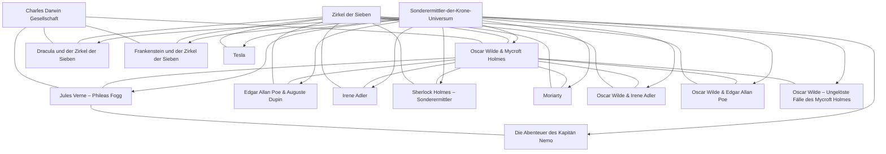

# Quellenlage & Kanonkarte

> Meta-Auswertung der Deep-Research-Recherche ([raw/deep-research-report.md](../../raw/deep-research-report.md)): Welche Quelle ist wofür belastbar, plus eine kondensierte Kanon-Beziehungskarte des Universums.

## Quellen-Eignung (welche Quelle wofür)

| Quelle | Stark für | Schwach / Lücken |
|---|---|---|
| **sonderermittler-der-krone.de** (Fanseite, Betreiber Tim Gerundt) | Reihenstruktur, Kanonzuordnung, Episodenreihenfolge, Episoden-/Cover-URLs, Kurzinhalt, Figurenliste | Vollständige Credits, Labels, exakte Handelsdaten, Katalognummern; ältere Folgen oft nur Jahr + Laufzeit; **redaktionelle Fehler** (siehe Tesla 1) |
| **HolyShop / Holysoft** | Maritim-Handelsdaten: Produkttyp, Label, Genre, Altersempfehlung, Format, oft exakte Erstveröffentlichung | „Mitwirkende" nicht immer offen ausgerollt; uneinheitlich indexierbar |
| **Kassettenkiste, Thalia, Audible, Apple Music, Storytel** | Blitz-Linien: exakte Erscheinungsdaten, Laufzeiten, EAN/ISBN, Sprecher, Plattformverfügbarkeit, teils Tracklisten | Tracklisten/Kapitelzeiten nur als Plattformdaten, nicht einheitlich über alle Folgen |
| **Black-Stone-/Zauberspiegel-Chronologie** | Serienübergreifende Kontinuität: Erstauftritte, Crossover-Ereignisse, In-Universe-Einordnung | Keine Primärquelle; nachrangig für reine Plot- oder Handelsdaten |

**Kernaufteilung:** Kanon & Ordnung → Fanseite; Verkaufs-/Handelsmetadaten → Händler; Kontinuität & Figurenwanderung → Chronologie.

## Neu bewertete Quellen (2026-09-06)

Ergebnis der Quellen-Scout-Recherche vom 06.09.2026. Alle drei sind **maschinenlesbare Schnittstellen ohne Zugangsschlüssel** und damit wiederholbar abrufbar — anders als die bisher genutzten HTML-Quellen.

| Quelle | Stark für | Schwach / Lücken |
|---|---|---|
| **Apple Music / iTunes Search API** (`itunes.apple.com/search`, Storefront DE) → [Rohdaten](../../raw/maritim/2026-09-06_apple-music-itunes-api_erscheinungsdaten.md) | **Exakte Erscheinungsdaten** für praktisch jede Folge der Hauptreihen (Fogg 1–52, OWMH 1–60, Poe & Dupin 1–36, Irene Adler 1–36, Dracula 1–16, Frankenstein 1–28, Sherlock 1–24, SHC 1–97); **Laufzeit** als Summe der Track-Zeiten (gegen 220 vorhandene `spielzeit_min`-Werte geprüft: 219 Treffer innerhalb ±2 min); Track-/Kapitelzahl; **kanonische Titelschreibweise inklusive Umlauten** | Keine Sprecher, keine EAN/ISBN. **Wichtigste Einschränkung:** Das gelieferte `releaseDate` ist das **digitale** Veröffentlichungsdatum und **nicht** durchgängig identisch mit dem Handelstermin, den der Vault bisher aus Fanseite und HolyShop bezogen hat. Gegenprobe an 135 Folgen, deren exaktes Datum bereits belegt war: **101 identisch (75 %), 34 abweichend** (diese Abweichungen hat der HolyShop-Abgleich vom 12.10.2026 überwiegend zugunsten von Apple aufgelöst, siehe Nachtrag unten), Spanne −77 bis +77 Tage. Verteilung ungleich — `irene-adler` 32/32, `sherlock-holmes` 18/20, aber `oscar-wilde-und-mycroft-holmes` nur 28/55. Reihen ohne vollständigen Streaming-Katalog: **Moriarty (0 Folgen), Tesla (nur Folge 1), Kapitän Nemo (4)**. **Verwechslungsgefahr:** Parallellinien mit eigener Zählung (`Aus den Archiven`, `Die alten Fälle (Reloaded)`), englische Ausgaben, Sammelboxen und die Roman-Lesereihe `In 80 Tagen um die Welt` müssen vor dem Parsen ausgefiltert werden |
| **Deezer API** (`api.deezer.com`) → [Rohdaten](../../raw/maritim/2026-09-06_deezer-api_erscheinungsdaten-und-upc.md) | Unabhängige **Zweitbestätigung** der Apple-Daten (106 von 113 neu gesetzten Daten doppelt belegt); **UPC/EAN** je Album | Feld `duration` ist **unbrauchbar** (Dracula 1: 2263 s = 37,7 min statt real ~70 min). Volltextsuche mischt Nachbarreihen ein, Filter über den Interpretennamen ist Pflicht. Keine Sprecher, keine Autor:innen |
| **DNB SRU** (Deutsche Nationalbibliothek, `services.dnb.de/sru/dnb`) | **ISBN/EAN** der CD-Ausgaben, Verlagsfirma (`Timm + Wilken oHG, Schenefeld` hinter dem Label Maritim), Erscheinungsjahr, Preisbindung; weist auch **geplante Titel** vor Erscheinen nach | Nur Jahresangabe, kein Tagesdatum. `dc:creator` ist die Firma, nicht die Autor:in — für Autorschaft unbrauchbar. Keine Sprecher. Titelschreibweise fehlerhaft (Beispiel: „Gegen jeden Wiederstand" statt „Widerstand") |
| **Hörspieltalk-Forum** (Ankündigungsthreads, geben die Verlagsvorschau wieder) | **Titel, Klappentext und Besetzung** kommender Folgen — oft Monate vor allen anderen Quellen und bislang ohne Gegenbeleg falsch | **Datumsangaben sind unbrauchbar.** Für die Herbst-2026-Staffel lagen sie durchgängig **zu früh**: SH 24 −70 Tage, FRANK 28 −49, IADK 35 −14, OWMH 60 −7 (Gegenprobe Apple Music + Deezer, 06.09.2026). Ursache ist vermutlich die Wiedergabe früher Vorschautermine, die der Verlag später verschiebt. **Regel: Titel und Inhalt von dort übernehmen, Termine niemals ohne Plattformbeleg.** Zusätzlich uneinheitlich bei der Verlagszuordnung — führt die WMU-Reihe unter „Maritim" statt „Blitz Verlag" (bildet den Vertriebsweg ab; Zuordnung Blitz am 12.10.2026 festgeschrieben) |

**Merksatz für den Datentyp:** Streaming-APIs sind die beste Quelle für das **Datum**. Bei der **Laufzeit** führt der in `raw/` belegte Wert der Fanseite; die Apple-Trackssumme ist nur Ersatz, wo die Fanseite keinen Wert nennt (sie lag in 15 Vergleichsfällen genau 1 min darüber — Regel bestätigt von Christian am 12.10.2026, siehe Fallstrick unten). Bibliotheks- und Händlerdaten für **ISBN/EAN und Verlag**, und weiterhin ausschließlich die Händler-Detailseiten (HolyShop, Audiolibrix, Nextory) für **Autor:in**. Für **Sprecher:innen** existiert bislang **keine** flächendeckende maschinenlesbare Quelle.

### Neu gefundene Quellen-Fallstricke

- **`autor` ist Einzelquelle und bleibt es — entschieden am 06.09.2026:** Die 221 am 06.09.2026 nachgetragenen Autorenangaben stammen ausschließlich aus der Hörbuchsparte der iTunes Search API; die Fanseite nennt keine Autor:innen, eine zweite flächige Quelle existiert nicht. Damit unterschreitet das Feld die sonst geltende Zwei-Quellen-Regel. **Entscheidung (Christian): Werte bleiben stehen, das Feld ist für die Vault-Ziele nachrangig.** Keine weitere Recherche, aber auch keine Belastung von Aussagen durch `autor`. Wer das Feld auswertet, behandelt es als Einzelbeleg.

- **Nummernkollision durch Parallellinien:** Die iTunes/Deezer-Suche liefert für Poe & Dupin die Reihe `Aus den Archiven` mit eigener Zählung 1–12 mit. Ungefiltert überschreibt „Aus den Archiven, Folge 12: Die Klinik-Morde" (20.11.2020) die echte Folge 12 „In den Katakomben lauert der Tod" (29.01.2021). Dasselbe Muster bei `Sherlock Holmes – Die alten Fälle (Reloaded)` und bei Fogg durch `In 80 Tagen um die Welt`.
- **Laufzeit-Widerspruch DNAPF 36 „Der letzte Tag auf Erden":** Vault 58 min, Apple-Music-Trackssumme 67,7 min. Einziger Ausreißer unter 220 Vergleichswerten — Klärung offen.
- **1-Minuten-Versatz Fanseite ↔ Apple-Trackssumme (Lint 12.10.2026):** Bei 15 Folgen (OWMH 1, 2 · EAPAD 3, 5, 7, 8, 10, 14, 17, 18, 19, 20 · WPO 1, 2, 4) lag die Apple-Summe genau 1 min **über** dem Fanseitenwert — vermutlich Aufrundung der Track-Summe gegenüber abgeschnittenen Minuten auf der Fanseite (Annahme, nicht belegt). Die Track-Summen selbst stehen in keiner `raw/`-Datei. `spielzeit_min` führt deshalb in diesen Fällen den in `raw/` belegten Fanseitenwert; die Apple-Summe bleibt für Folgen ohne Fanseitenwert maßgeblich. Details: [[wiki/queries/lint-2026-10-12|Lint 2026-10-12]].
- **Zwei Datumsbegriffe — entschieden am 06.09.2026:** Die an diesem Tag nachgetragenen 113 Erscheinungsdaten sind **digitale Veröffentlichungsdaten** aus Apple Music (106 davon zusätzlich durch Deezer bestätigt). Für Folgen, deren Handelstermin bereits belegt war, weichen diese in rund einem Viertel der Fälle ab. Das Feld `erschienen` mischt damit zwei Ereignisarten. **Entscheidung (Christian): bleibt so.** Kein neues Feld, keine Rücknahme. Begründung: `erschienen` dient im Vault nicht der Handelsdokumentation, sondern als Indiz für die **Timeline und für Handlungsverläufe zwischen Serien**. Dafür reicht die Genauigkeit — siehe die Granularitätsregel unten. Jede betroffene Folgenseite nennt die Quelle weiterhin im Eckdaten-Abschnitt; überschrieben wurde kein bereits tagesgenau belegtes Datum (Gegenprobe gegen den Stand vor dem Lauf: 114 Einträge neu datiert, davon 73 vorher jahresgenau und 41 ohne Datum, **0 Regressionen**).
  - **Revidiert am 12.10.2026 (Entscheidung Christian):** Die Voraussetzung, die abweichenden Vault-Werte seien belegte Handelstermine, trifft nicht zu — die HolyShop-Ersterscheinung stimmt in 34 Fällen mit Apple überein und widerspricht dem Vault; die Vault-Werte stammten überwiegend aus der „Repo-Timeline“ der Anlagephase bzw. der Löchel-Chronologie. Diese 34 Folgen und MOR 25 führen seitdem die Ersterscheinung. Für die übrigen Folgen gilt weiter: `erschienen` = Ersterscheinung (digital), siehe „Drei Datumsebenen“ unten. Tabelle alt → neu: [[wiki/queries/lint-2026-10-12|Lint 2026-10-12, Nachtrag 4]].

> [!important] Granularitätsregel für `erschienen`
> **Belastbar ist die Zuordnung zum Release-Block, nicht die tagesgenaue Reihenfolge zwischen Serien.**
>
> Maritim liefert mehrere Serien im selben Schwung aus. Von den 141 tagesgenau neu datierten Folgen liegen **118 innerhalb einer Woche** neben einer Folge aus einer anderen Serie, und die Abstände häufen sich exakt auf **0 und 7 Tage** — das ist der Veröffentlichungstakt, keine Streuung. Beispiele: DNAPF 19 und OWMH 20 beide am 29.03.2019, DNAPF 20 und OWMH 21 beide am 31.05.2019, EAPAD 6 am 26.07.2019 und OWMH 22 am 31.07.2019 (bis 12.10.2026 im Vault ebenfalls 26.07.2019 — ein Beispiel dafür, dass erst die Block-Zuordnung trägt, nicht der Tag). Die Zählung 141/118 bezieht sich auf den Stand vom 06.09.2026.
>
> Daraus folgt:
> - **Zulässig:** „Diese Folgen gehören zum selben Release-Block" — trägt die Aussage, dass zwei Serien einen Handlungsstrang parallel führen.
> - **Unzulässig:** „Folge A erschien vor Folge B", wenn der Abstand unter etwa einer Woche liegt. Dort entscheidet bei den neu datierten Folgen der Distributionszeitpunkt, nicht der Handelstermin; ein Fehler von wenigen Tagen kippt das Paar.
>
> Die Timeline-App sortiert bei gleichem Datum deterministisch nach `serie` und `nummer` (`compareFolgen` in `app/app.js`) — die Anzeige ist damit stabil, stellt aber ausdrücklich **keine** belegte Reihenfolge dar.

## Neu bewertete Quellen (2026-10-12)

Aus der Prüfung, ob der Hawthorn des Fogg-Afrika-Blocks der [[wiki/figuren/abel-hawthorn|Abel Hawthorn]] aus OWMH ist ([Rohdaten](../../raw/maritim/2026-10-12_fanseite-fandom-audible_abel-hawthorn-auftritte-und-sprecher.md)).

| Quelle | Stark für | Schwach / Lücken |
|---|---|---|
| **Fandom-Wiki sherlockholmes.fandom.com/de über die MediaWiki-API** (`api.php?action=query&prop=revisions`, ohne Zugangsschlüssel) | **Rollengenaue Besetzung** (Tabelle Rolle → Sprecher) für **alle** OWMH-Folgen 1–44; maschinenlesbar, wiederholbar, Volltextsuche über `list=search`. Bislang einzige Repo-Quelle, die Sprecher **einer Rolle** zuordnet | Nur OWMH 1–44 (ab 45 keine Einzelseiten), keine Seiten zu DNAPF 37 ff. und WMU. **Inkonsistent:** „Kalter Fels" (OWMH 5) nennt den „ersten Auftritt" Hawthorns, obwohl die eigene Seite zu OWMH 2 ihn schon besetzt; Schreibweise der Rolle wechselt (Hawthorn/Hawthorne). Erscheinungsdaten teils nur Jahr, Laufzeiten gerundet („ca. 60" für 79 min). Der Suchindex ist unvollständig — vollständige Prüfung nur über den Seitenabruf, nicht über `list=search` |
| **Audible.de-Produktseiten** (Feld `narrators` bzw. „Sprecher beinhaltet …") | **Vollständige Sprecherliste je Folge**, auch für DNAPF und WMU; per `curl` mit Browser-User-Agent abrufbar (Python-`urllib` wird mit HTTP 503 abgewiesen) | **Keine Rollenzuordnung** — taugt nur als Indiz („Sprecher X ist besetzt"), nicht als Beleg für eine Rolle. `releaseDate` ist ein Plattformdatum und weicht teils ab (DNAPF 42: 29.10.2024 statt 18.10.2024, WMU 1: 09.02.2026 statt 23.01.2026) — **Muster bestätigt** im Nachtrag unten: Audible liegt nie wesentlich vor dem Hauptrelease, oft danach. Sprecherliste auf 15 Namen gekürzt |

**Merksatz Sprecher:** Rolle ↔ Sprecher nur aus Fandom (OWMH 1–44) oder einer Besetzungsliste mit Rollen (Hörspieltalk OWMH 58–60); Audible-Listen ohne Rollen allein reichen nicht. Für Hauptfiguren ist die Ableitung über die Stammsprecher der Fanseiten-Figurenseiten zulässig, wenn sie als abgeleitet gekennzeichnet ist (siehe Nachtrag unten). Namensgleiche Sprecher auseinanderhalten — **Jaron** Löwenberg (Hawthorn) und **Holger** Löwenberg (Henry Wheeler).

## Neu bewertete Quellen (2026-10-12, Nachtrag Datum und Besetzung)

Aus der Klärung der Audible-Datumskonflikte und der Besetzungssuche für OWMH 45–60 ([Rohdaten Datum](../../raw/maritim/2026-10-12_audible-holyshop-rautemedia_erscheinungsdaten-abgleich.md), [Rohdaten Besetzung](../../raw/maritim/2026-10-12_audible-hoerspieltalk-rautemedia-fanseite_owmh-45-60-besetzung.md)).

| Quelle | Stark für | Schwach / Lücken |
|---|---|---|
| **HolyShop-Produktseiten, Feld „Ersterscheinung"** (`shop.holysoft.de/produkte/…`, alle 279 Folgen der acht Maritim-Reihen maschinell abgerufen) | **Tagesgenaues Erstveröffentlichungsdatum** für praktisch jede Maritim-Folge, dazu „im HolyShop erhältlich ab" (teils eine Woche später, bei DNAPF 42 = CD-Termin). Erstmals eine vollständige, wiederholbare Handelsquelle für `erschienen`: 239 von 277 Werten identisch mit dem Vault | Keine Blitz-Reihen (WMU, Tesla, Nemo). Feld „Mitwirkende" durchgehend leer. **Einzelfehler:** OWMH 40 trägt den Termin von OWMH 41; FRANK 20, SH 16 und EAPAD 29 je 1–2 Wochen gegen Apple, Deezer und Audible |
| **Raute Media** (`rautemedia.de/produkt/…`, CD-Vertrieb, Label All Ears) | **CD-Termin** („Veröffentlichung") und **vollständige Sprecherliste** der CD (nicht auf 15 Namen gekürzt) | Keine Rollen. Nur ein Teil der Folgen auffindbar (Volltextsuche). CD liegt teils eine Woche nach der Ersterscheinung (DNAPF 39, 42, OWMH 54, MOR 7) |
| **Fanseite, Figurenseiten** (`/figuren/<slug>/`, Abschnitt „Sprecher") | **Stammsprecher:in je Hauptfigur** (21 Figuren, z. B. Wilde – Rotermund, Sherlock – Rettinghaus, Adler – Greitzke, Frankenstein – Wunder); deckt sich mit allen Fandom-Rollentabellen | Keine Folgenbesetzung, keine Umbesetzungen; die „Folgenübersicht" der Figurenseiten ist für OWMH 45 ff. lückenhaft (nur Wilde und Mycroft) |
| **Hörspieltalk, Ankündigungsthreads** (Ergänzung zur Bewertung vom 06.09.) | **Rollenlisten** der Verlagsvorschau, allerdings nur vereinzelt (OWMH 58, 59, 60); sonst Namenslisten wie Audible und Raute Media | Rollen nur Einzelquelle; für OWMH 45–48 keine Einzelthreads; Termine weiter unzuverlässig (die bis 12.10.2026 geführten Vault-Daten von OWMH 48/49 entsprachen frühen Vorschauterminen der Folgefolgen) |
| **DNB, MARC21-Feld 245 $c** | nennt bei Blitz-CDs die **Hauptrolle mit Sprecher** („Oscar Wilde Sascha Rotermund [und weitere]") | Nur die erste Rolle; Feld 883 ist ein Meldedatum, kein Erscheinungstermin |

**Audible-Muster (281 Folgen geprüft):** 163 × gleich dem Vault, 72 × später bei sonst übereinstimmendem Vault/Apple (3–363 Tage, Median 24), Ausreißer bis 1694 Tage (OWMH 22) und ein Platzhalter „01.01.2200" (EAPAD 12). Spätere Daten häufen sich auf Sammeltage (z. B. 05./06.10.2017 für DNAPF 6–11 und OWMH 8–11 zugleich) — Katalog-Nachlieferungen, keine Veröffentlichungstermine. **Regel: Audible-`releaseDate` nie für `erschienen` verwenden.** Für DNAPF 42 und WMU 1 bleibt der Vault-Wert (Ersterscheinung bzw. Hauptrelease) stehen.

**Drei Datumsebenen bei Maritim:** Ersterscheinung (digital, HolyShop „Ersterscheinung", meist = Apple/Deezer) → CD (Raute Media, gleich oder eine Woche später) → Hörbuchplattformen (Audible, oft später). `erschienen` meint die **Ersterscheinung**; für die Granularitätsregel (Release-Block) ist der Unterschied zur CD unerheblich.

**Rollenzuordnung abgeleitet (OWMH 45–57):** Wo keine Rollenliste existiert, trägt der Vault die Hauptrollen nur dann ein, wenn (a) die Figur im offiziellen Klappentext oder in der Figurenliste der Fanseite steht, (b) die Fanseiten-Figurenseite (bzw. Fandom) ihren Stammsprecher nennt und (c) diese:r in der Sprecherliste der Folge steht. Die Folgenseite kennzeichnet das als „abgeleitet". Nebenrollen bleiben ohne Rollenliste offen.

## Korpus-Stand laut Report

- **305 offiziell gelistete Episoden** in **15 Serienlinien** (Kernreihen, Charakter-Spin-offs, Antagonistenreihen, zwei „Aus den Archiven"-Re-Brandings, Blitz-Mini-/Neureihen 2024–2026).
- Korpus ist **kanonisch indexiert, aber publizistisch in Bewegung**: Händler weisen 2026 bereits weiterlaufende/geplante Titel aus (u. a. Irene Adler, Moriarty, Poe & Dupin, Phileas Fogg, Frankenstein, Sherlock, OWMH), die auf der Fanseite noch nicht voll gespiegelt sind.
- Der vorliegende Vault deckt diesen 305-Folgen-Korpus inhaltlich bereits ab (Stand siehe [[log|log.md]]).

## Bekannte Datenfehler der Primärquelle

- **Tesla 1:** Fanseite labelt fälschlich „Im Spannungsfeld"; korrekt **„Die Kraft des Lichts"** (Cover `cover-m-tesla-01.jpg`, Thalia EAN 9783689842109, Kassettenkiste). „Im Spannungsfeld" ist der echte Titel von [[wiki/folgen/tesla-04-im-spannungsfeld|Tesla 4]]. Im Vault korrigiert → [[wiki/folgen/tesla-01-die-kraft-des-lichts|Tesla 1: Die Kraft des Lichts]]. Die offizielle URL behält den falschen Slug `folge01-im-spannungsfeld`.
- **Phileas Fogg 17 „Wie alles begann":** Fanseite wirkt fehlerhaft, dupliziert offenbar Folge 16 (bereits im Vault notiert).
- **Oscar Wilde & Irene Adler 3 „Ein Sommernachtsalbtraum":** Fanseite dupliziert offenbar Folge 2 (bereits im Vault notiert).
- **Sherlock Holmes 23 „Der Wiedergänger von Soho" (gefunden 12.10.2026):** Die Folgenseite nennt als Erscheinungsdatum **10.09.2026**; HolyShop, Apple Music, Deezer und die eigene Schlagzeile der Fanseite („Freitag erscheint …", 06.10.2026) belegen den **09.10.2026**. Neues Fehlermuster neben den Titeldubletten: **Tag/Monat-Dreher** (zweiter Fall: MOR 25, siehe unten). Im Vault gilt der 09.10.2026 → [[wiki/folgen/sherlock-holmes-23-der-wiedergaenger-von-soho|SH 23]]. Beleg: [Rohdaten](../../raw/maritim/2026-10-12_sonderermittler-der-krone_de_holyshop_dnb_folgen-okt-dez-2026.md).
- **Moriarty 25 „Ein Hauch von Ewigkeit" (gefunden und korrigiert 12.10.2026) — zweiter Tag/Monat-Dreher:** Die Folgenseite nennt **06.05.2026** (ein Mittwoch); HolyShop (Ersterscheinung und Vorankündigung), Apple Music, Deezer, Audible und die eigene Schlagzeile der Fanseite (04.06.) belegen den **05.06.2026**. Gleiches Muster wie SH 23: Die Folgenseite vertauscht Tag und Monat, Schlagzeile und Handelsquellen stimmen. Im Vault gilt der 05.06.2026 → [[wiki/folgen/moriarty-25-ein-hauch-von-ewigkeit|MOR 25]]; die frühere Einschätzung der Serienseite, der Mai-Termin sei plausibler, ist aufgelöst. Beleg: [Rohdaten](../../raw/maritim/2026-10-12_audible-holyshop-rautemedia_erscheinungsdaten-abgleich.md). **Faustregel (Annahme, nicht systematisch geprüft):** Liegt ein Fanseiten-Datum nicht auf einem Freitag und ergibt die Vertauschung von Tag und Monat einen Freitag im Takt der Reihe, gegen Handelsquellen prüfen.
- **„Repo-Timeline"-Daten OWMH (gefunden 12.10.2026):** Die tagesgenauen OWMH-Daten aus der Anlagephase (`raw/maritim/2026-04-28_owmh_folgen-05-bis-56.md`, „Repo-Timeline Erscheinungsdatum") sind **kein Handelsbeleg** — die Fanseite nennt für OWMH 45–55 nur das Jahr. Bei 28 OWMH-Folgen widerspricht die HolyShop-Ersterscheinung dem Vault, in 27 davon zusammen mit Apple (meist auch Audible); OWMH 46–49 tragen jeweils den Termin der Folgefolge. Die Entscheidung vom 06.09.2026 („Zwei Datumsbegriffe — bleibt so") ging davon aus, dass diese Werte Handelstermine sind. Tabelle aller 38 Abweichungen in den [Rohdaten](../../raw/maritim/2026-10-12_audible-holyshop-rautemedia_erscheinungsdaten-abgleich.md).
  - **Umgesetzt am 12.10.2026:** 34 Folgen (27 OWMH, DNAPF 8, 11, 12, EAPAD 1, 2, SH 1, FRANK 26) auf die mit Apple übereinstimmende HolyShop-Ersterscheinung umgestellt, dazu MOR 25. Offen bleiben FRANK 20, OWMH 40 und EAPAD 29, wo HolyShop allein gegen Apple steht. Details: [[wiki/queries/lint-2026-10-12|Lint 2026-10-12, Nachtrag 4]].

## Kanon-Beziehungskarte

> Stellt **Beziehungen** dar, nicht Besitzverhältnisse. Quelle: Deep-Research-Report, basierend auf Fanseite + Chronologie.

Verbindende Cluster sind weniger Gastauftritte als **wiederkehrende Verschwörungs- und Forschungsstrukturen**: der [[wiki/konzepte/zirkel-der-sieben|Zirkel der Sieben]] und die [[wiki/konzepte/charles-darwin-gesellschaft|Charles Darwin Gesellschaft]].

## Offene Punkte (nicht ingestiert)

Der Report enthält darüber hinaus **Handels-/Katalogmetadaten** (EAN/ISBN, Laufzeiten, Retailer-Links, Formate) — bislang nur für zwei Beispielepisoden voll ausgearbeitet (Tesla 1, Irene Adler 1). Eine flächige Aufnahme dieser Daten würde eine Schema-Erweiterung erfordern und ist bewusst **nicht** Teil dieses Ingests (Entscheidung Christian, 2026-05-27).

**Nachtrag 2026-09-06:** Die **UPC/EAN** liegen seitdem für einen großen Teil des Korpus maschinell abgerufen vor (siehe [Deezer-Rohdaten](../../raw/maritim/2026-09-06_deezer-api_erscheinungsdaten-und-upc.md)), zusätzlich die ISBN der CD-Ausgaben über DNB SRU. Sie sind **weiterhin nicht** ins Schema aufgenommen — die Entscheidung von 2026-05-27 gilt unverändert; die Daten liegen jetzt lediglich abrufbereit unter `raw/`.

## Quellen

- [raw/deep-research-report.md](../../raw/deep-research-report.md)
- [raw/maritim/2026-10-12_fanseite-fandom-audible_abel-hawthorn-auftritte-und-sprecher.md](../../raw/maritim/2026-10-12_fanseite-fandom-audible_abel-hawthorn-auftritte-und-sprecher.md) — Fandom-API- und Audible-Bewertung (12.10.2026)
- [raw/maritim/2026-10-12_audible-holyshop-rautemedia_erscheinungsdaten-abgleich.md](../../raw/maritim/2026-10-12_audible-holyshop-rautemedia_erscheinungsdaten-abgleich.md) — Audible-, HolyShop- und Raute-Media-Datumsabgleich (12.10.2026)
- [raw/maritim/2026-10-12_audible-hoerspieltalk-rautemedia-fanseite_owmh-45-60-besetzung.md](../../raw/maritim/2026-10-12_audible-hoerspieltalk-rautemedia-fanseite_owmh-45-60-besetzung.md) — Besetzung OWMH 45–60, Fanseiten-Figurenseiten (12.10.2026)
